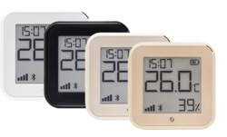
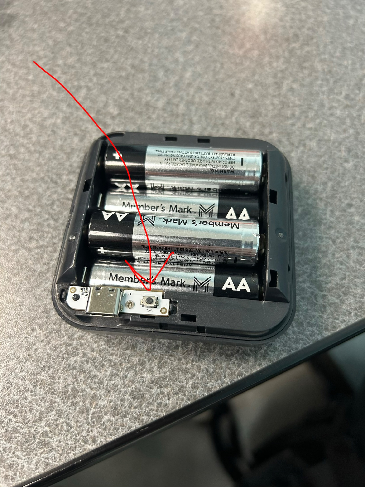
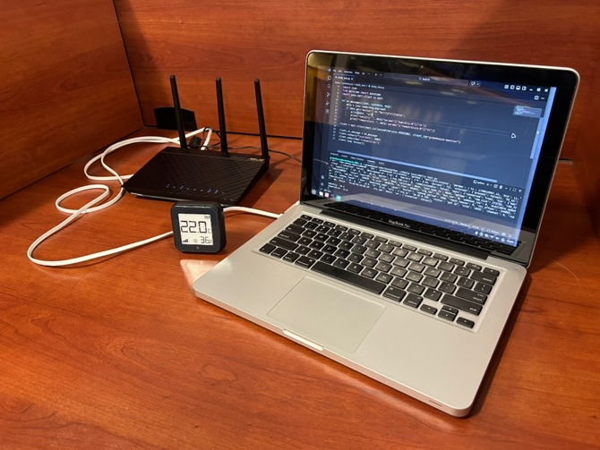
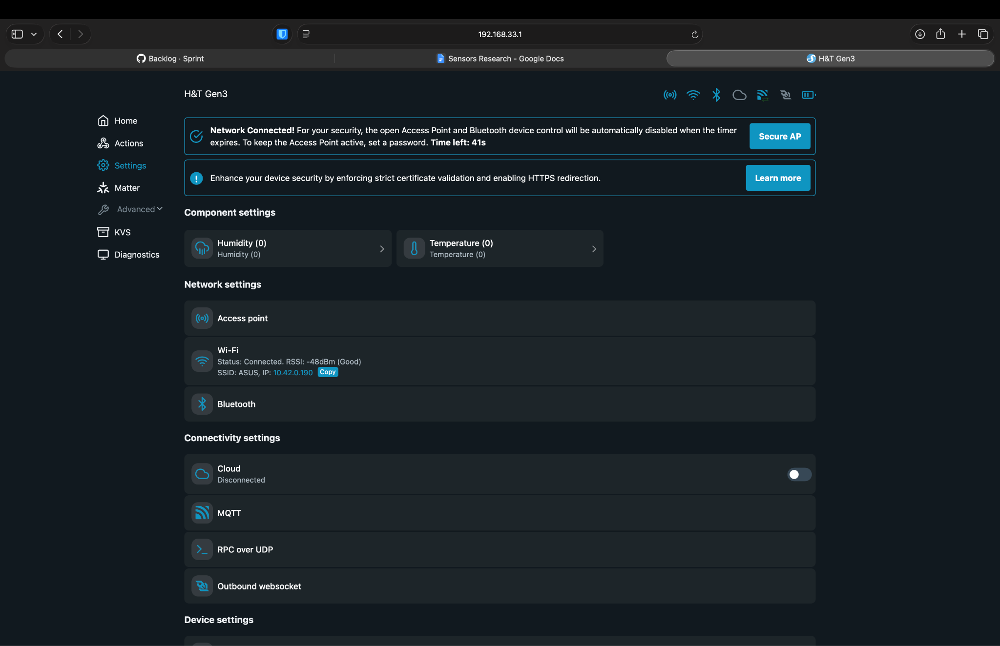
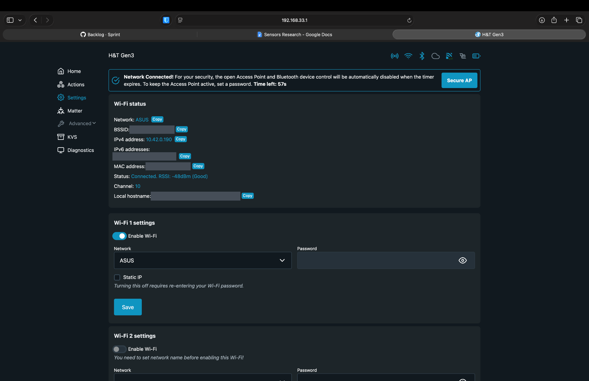
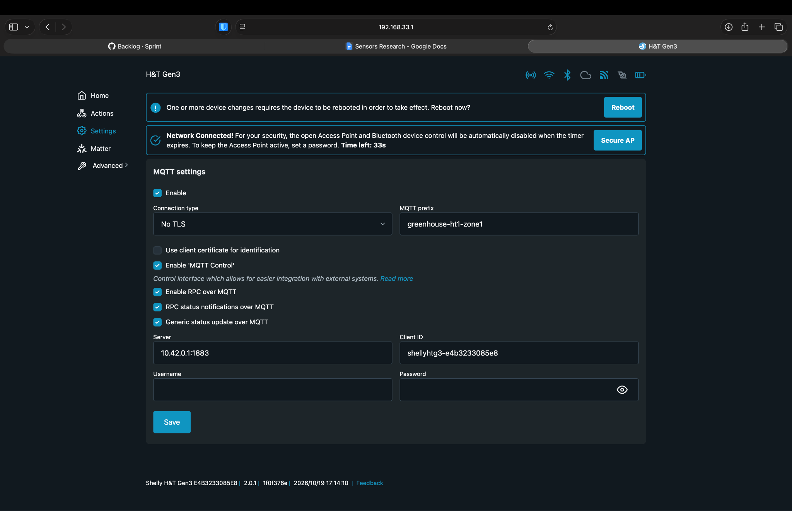

# Shelly Sensor Research Doc

**Model:** H&T gen3

*A compiled paper on what Shelly is, does, pros/cons, and greenhouse setup*

### Links

- [Shelly H&T](https://shelly-api-docs.shelly.cloud/gen2/Devices/Gen3/ShellyHTG3/)
- [General device info](https://kb.shelly.cloud/knowledge-base/shelly-h-t-gen3)
- [Web interface](https://kb.shelly.cloud/knowledge-base/shelly-h-t-gen3-web-interface-guide)
- [MQTT Docs](https://shelly-api-docs.shelly.cloud/gen2/ComponentsAndServices/Mqtt)

---

## What Exactly is a Shelly H&T Gen 3 Sensor?

These are small, battery-efficient devices that can be used to monitor temperature and relative humidity. The data can be stored in our database and used to create graph trends for greenhouse conditions monitoring.

Here is what the particular sensor looks like:

Shelly sensors can be attached to walls away from direct sunlight and water. [Basic Gen 3 information](https://www.shelly.com/blogs/documentation/shelly-h-t-gen3)

## What a Shelly H&T Gen 3 Does

These devices are power efficient because they spend most of their life sleeping, then wake to report readings when temperature or humidity changes by a set threshold, but no more than once every 5 minutes, otherwise every two hours. When the device wakes, it pushes readings to our broker (server) over MQTT.

## Sensor Communication Protocol: MQTT

MQTT is a lightweight, low-bandwidth messaging protocol designed for the Internet of Things (IoT). Why are we choosing MQTT? This gives us a way to receive updates from the shelly without having to request updates. The Shelly will spend most of its life asleep. This means that polling the device while it is asleep will result in timeout. We must allow the device to push updates to us. MQTT uses publish-subscribe which is like the observer pattern but with a broker (server) as a mediator so the Shelly and macbook never talk directly.

A significant advantage of MQTT over another protocol such as webhooks is that for S sensors, we only have to add the broker address S times no matter how many subscribers there are. For webhooks, the amount of webhooks we will write corresponds to the multiple of sensors, events, and subscribers. This is significantly more configuration overhead depending on how many subscribers there will be to the sensors. Subscribers could be any program that needs sensor data including our app, a logger that writes to the database, a dashboard displaying live data, or an alert script that notifies when temperature goes out of range.

The other factor that is nice is that over MQTT the Shelly will send each reading’s full status as a JSON object on every update so if we want to capture another attribute it will cost one additional line of code to extract that data versus changing the URL for the ENTIRE webhook multiple discussed earlier. The Shelly webhook interface also warns the impact of battery life webhooks have on the device which increases maintenance upkeep.

### Mediator Pattern Refresher

> A concept discussed in CS3, it is a behavioral design pattern where objects communicate through a central mediator instead of directly with each other, which reduces dependency between them. In our setup the broker is the mediator: the Shelly publishes to the broker, and subscribers get the data from the broker, so the Shelly and the macbook never talk directly.

## Pros and Cons

### Pros

- **Battery efficient.** The Shelly spends most of its life asleep and only wakes to report, so batteries last a long time and maintenance is low.
- **Pushes data to us.** We never have to poll a sleeping device, so there are no timeouts.
- **Low configuration overhead.** Each sensor only needs the broker address once, no matter how many subscribers there are (vs. sensors × events × subscribers for webhooks).
- **Full JSON on every update.** Capturing a new attribute costs one line of code.
- **Ready-made hardware.** No wiring or soldering like the Pico + DHT setup, and configuration is done through a web interface.

### Cons

- **Humidity range.** Shelly recommends 30–70% relative humidity and gives no water-resistance rating. Our tropical greenhouse will likely be close to 70% or even above that mark, which could affect accuracy and sensor lifespan.
- **Not real-time.** On battery, the Shelly reports at most once every 5 minutes, even when a threshold is crossed. Normally, the Shelly will report once every 2 hours.
- **Depends on the gateway.** If the ASUS router or the MacBook goes down, no data reaches the database.
- **Hard to reconfigure.** The web interface only works while the Shelly is awake or in “set” mode.

---

## Shelly Setup Using Greenhouse Macbook

  
  &nbsp;
  

### Phase 1: Connect to the sensor

1. Open the back panel and press the button inside one time. The screen should show only **“set”**. This mode flips back to normal every few minutes. The web interface will stop working because it is only visible in “set” mode.
2. On the greenhouse MacBook’s laptop, join the sensor’s own Wi-Fi network. It’s named **ShellyHTG3-XXXXXXXXXXXX**, where the X’s are the device ID.
3. In a browser, go to **192.168.33.1**. This address is the same for every Shelly in setup mode. You should now see the Shelly web dashboard.

### Phase 2: Join the private router network wifi

4. Go to **Settings → Wi-Fi**.
5. Under **Wi-Fi 1**, select **ASUS**
6. Click **Enable Wi-Fi** and then **Save** for Wi-Fi 1.
7. Wait for the new **IPV4 address** to appear at the top below the **Wi-Fi status** text box. This confirms the connection to ASUS network.

### Phase 3: Point the sensor at the broker

8. Go to **Settings → MQTT** and check **Enable**.
9. Fill in the fields:

| Field | Value |
|---|---|
| **Server** | **MacBook ethernet IP-> 10.42.0.1:1883** |
| **Client ID** | leave the default (the device ID) **must be unique or broker will drop duplicate clients** |
| **MQTT prefix** | greenhouse-ht1-zone1 (you can change sensor number and zone) |
| **RPC status notifications over MQTT** | **On** |
| **Generic status update over MQTT** | **On** |
| **SSL** | **Off** — enabling it roughly halves battery life |
| **Username / password** | **Blank** |

### Phase 4: Reporting settings

10. **Settings → Temperature → Delta threshold**: set it to [0.5 °C]. The sensor wakes and reports when the temperature moves by this much.
11. **Settings → Humidity → Delta threshold**: set it to [1 %].
12. **Settings → Temperature units**: set to [°C]. The database should standardize on one unit.

### Phase 5: Confirm end to end

13. Reconnect the Greenhouse MacBook to **“Kent State Guest”** network.
14. Check greenhouse_gateway/README.md in the repo for how to run the subscriber script and test sensors.
15. To force the Shelly to send a reading, press the button inside the back panel from step 1.
16. You should see the reading print in the gateway script’s terminal within a few seconds.

---

## What the Setup is Actually Doing

We are sending sensor data over a private network created by the ASUS router. The Shellys join it over the router’s Wi-Fi (named ASUS), and the greenhouse MacBook is plugged into the WAN port by ethernet. On the greenhouse MacBook, that wired connection is saved as ‘PICO Bridge.’ Since the router forwards the Shelly’s traffic out its WAN port to the MacBook, the Shelly can reach the MacBook’s ethernet IP (10.42.0.1), which is the broker address we put in the MQTT section. The MacBook’s own Wi-Fi stays on Kent State Guest for sending data to our API on Kent State’s Cassini server, so it becomes the greenhouse gateway connected to both networks at the same time.
